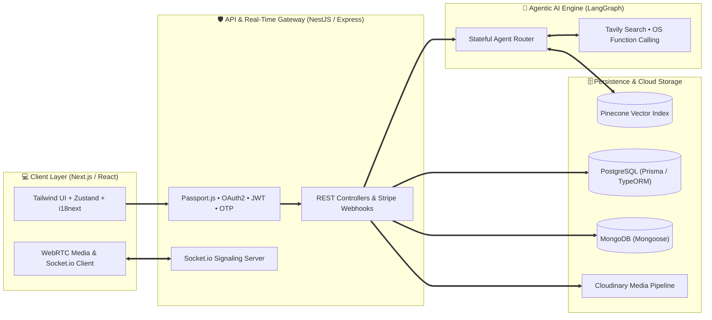

<div align="center">

<!-- 🌌 SECTION 1: ULTRA-CLEAN GEOMETRIC HERO HEADER -->


<!-- ⚡ LIVE SYSTEM STATUS PILLS -->
<p align="center">
  
  
  
</p>

<!-- ⌨️ CRISP SINGLE-LINE TERMINAL STREAM -->
<a href="https://git.io/typing-svg">
  
</a>

<br/>

<!-- 🛡️ MINIMALIST COMMAND BAR -->
<p align="center">
  <a href="https://linkedin.com/in/YOUR_LINKEDIN_USERNAME" target="_blank">
    
  </a>
  <a href="https://YOUR_PORTFOLIO_URL" target="_blank">
    
  </a>
  <a href="mailto:daniyalkarim70@gmail.com">
    
  </a>
  <a href="https://instagram.com/daniyalkarim43" target="_blank">
    
  </a>
</p>


</div>

<!-- 🧠 SECTION 2: BALANCED BENTO ARCHITECTURE OVERVIEW -->
## ⚡ Engineering Domains & System Profile

<table width="100%">
<tr>
<td width="52%" valign="top">

### 🎯 What I Architect & Ship

<table>
  <tr>
    <td><b>🤖 Agentic AI</b></td>
    <td>Stateful <b>LangGraph</b> workflows, <b>Pinecone</b> vector RAG, <b>Tavily</b> search tools & OS function calling.</td>
  </tr>
  <tr>
    <td><b>🏗️ Core Stack</b></td>
    <td>Scalable <b>Next.js</b> & <b>React</b> interfaces backed by modular <b>NestJS</b> & <b>Express.js</b> APIs.</td>
  </tr>
  <tr>
    <td><b>📡 Real-Time</b></td>
    <td>Low-latency <b>WebRTC</b> video streaming & bidirectional <b>Socket.io</b> messaging engines.</td>
  </tr>
  <tr>
    <td><b>🗄️ Data Layer</b></td>
    <td>Relational & NoSQL modeling with <b>PostgreSQL</b> (Prisma / TypeORM) & <b>MongoDB</b> (Mongoose).</td>
  </tr>
  <tr>
    <td><b>🔐 Auth & Pay</b></td>
    <td><b>Passport.js</b> Google OAuth2, JWT middleware, OTP verification, <b>Cloudinary</b> & <b>Stripe</b> checkouts.</td>
  </tr>
</table>

</td>
<td width="48%" valign="top">

### 🖥️ `daniyal.config.ts`

```ts
export const EngineerProfile = {
  name: "Daniyal Karim",
  role: "Full-Stack & AI Systems Engineer",
  education: "CS @ Degree College Aliabad, Hunza",
  experience: "Full-Stack Dev (ex-uConnect)",

  coreStack: {
    frontend: ["Next.js", "React", "Tailwind", "Zustand"],
    backend:  ["NestJS", "Node.js", "Express", "REST"],
    database: ["PostgreSQL", "MongoDB", "Prisma", "TypeORM"],
    ai_layer: ["LangGraph", "Pinecone", "Tavily", "RAG"],
    realtime: ["Socket.io", "WebRTC", "Stripe", "OAuth2"]
  },

  currentFocus: "High-Concurrency SaaS & AI Agents"
} as const;
```

</td>
</tr>
</table>


<!-- 🏛️ SECTION 3: INTERACTIVE ARCHITECTURE DIAGRAM -->
## 🏛️ End-to-End System Topology

> *Live architecture blueprint illustrating how my frontend, backend, database, and AI layers interact in production:*




<!-- 🛠️ SECTION 4: FULL-STACK & AI TECH ARSENAL -->
## 🛠️ Full-Stack & AI Tech Arsenal

<div align="center">

| Domain | Core Technologies & Frameworks |
| :--- | :--- |
| **Frontend Engineering** |       |
| **Backend & Real-Time** |      |
| **Databases & ORMs** |      |
| **AI, Auth & Cloud Infra** |      |

</div>


<!-- 🚀 SECTION 5: FLAGSHIP PRODUCTION SYSTEMS -->
## 🚀 Flagship Production Systems

<table>
  <tr>
    <td width="50%" valign="top">
      <h3>🤖 Multi-Agent Conversational & OS Assistant</h3>
      <p><b>Stack:</b> <code>LangGraph</code> • <code>Tavily Search</code> • <code>Pinecone</code> • <code>Next.js</code> • <code>Node.js</code></p>
      <ul>
        <li>Engineered a stateful multi-agent pipeline capable of dynamic tool-calling, persistent conversation history, and semantic vector retrieval.</li>
        <li>Integrated autonomous web search via <b>Tavily</b> and custom OS-level function execution handlers for local system automation.</li>
      </ul>
      <p>
        <a href="https://github.com/daniyalkarim0340"></a>
      </p>
    </td>
    <td width="50%" valign="top">
      <h3>🍔 Full-Stack Commerce & Food Delivery Platform</h3>
      <p><b>Stack:</b> <code>React / Next.js</code> • <code>NestJS / Express</code> • <code>MongoDB / PostgreSQL</code> • <code>Stripe</code></p>
      <ul>
        <li>Architected end-to-end ordering workflows, cart state persistence with <b>Zustand</b>, and secure <b>Stripe Checkout</b> webhook processing.</li>
        <li>Built custom JWT + Google OAuth2 authentication via <b>Passport.js</b>, OTP email verification, and <b>Cloudinary/Multer</b> media pipelines.</li>
      </ul>
      <p>
        <a href="https://github.com/daniyalkarim0340"></a>
      </p>
    </td>
  </tr>
  <tr>
    <td width="50%" valign="top">
      <h3>📡 Real-Time Video & Chat Communication Engine</h3>
      <p><b>Stack:</b> <code>WebRTC</code> • <code>Socket.io</code> • <code>TypeScript</code> • <code>Tailwind CSS</code> • <code>Node.js</code></p>
      <ul>
        <li>Developed peer-to-peer low-latency video streaming rooms using <b>WebRTC</b> paired with custom <b>Socket.io</b> signaling servers.</li>
        <li>Implemented instant messaging channels, presence tracking, and responsive multi-device UI layouts.</li>
      </ul>
      <p>
        <a href="https://github.com/daniyalkarim0340"></a>
      </p>
    </td>
    <td width="50%" valign="top">
      <h3>🏥 Multi-Hospital Management System Architecture</h3>
      <p><b>Stack:</b> <code>NestJS</code> • <code>PostgreSQL</code> • <code>Prisma / TypeORM</code> • <code>RBAC</code> • <code>Next.js</code></p>
      <ul>
        <li>Designed multi-tenant role hierarchies (Admin, Doctor, Patient, Reception) with strict permission guards and audit logging.</li>
        <li>Modeled relational schemas for appointment scheduling, electronic records, and automated billing workflows.</li>
      </ul>
      <p>
        <a href="https://github.com/daniyalkarim0340"></a>
      </p>
    </td>
  </tr>
</table>


<!-- 📊 SECTION 6: LIVE GITHUB TELEMETRY & ANALYTICS -->
## 📊 Live GitHub Telemetry & Analytics

<div align="center">

<!-- 📈 UNIFIED SUMMARY CARDS -->


<br/><br/>

<table border="0" cellspacing="0" cellpadding="0">
  <tr>
    <td align="center">
      
    </td>
    <td align="center">
      
    </td>
  </tr>
</table>

<br/>

<table border="0" cellspacing="0" cellpadding="0">
  <tr>
    <td align="center">
      
    </td>
    <td align="center">
      
    </td>
  </tr>
</table>

<br/>

<!-- 🌐 REAL-TIME COMMIT GRAPH -->


</div>

<br/>

<!-- 🤝 SECTION 7: FOOTER -->
<div align="center">


### ⚡ Let's Build High-Impact Systems Together
*Open for Full-Stack Product Engineering, Agentic AI Pipelines, and Scalable Backend Architecture.*

<p align="center">
  <a href="mailto:daniyalkarim70@gmail.com">
    
  </a>
</p>


</div>
