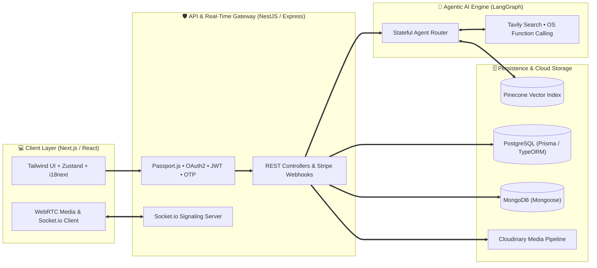

<div align="center">

<!-- 🌌 DYNAMIC CYBERNETIC HERO BANNER -->


<!-- ⌨️ TERMINAL EXECUTION STREAM -->
<a href="https://git.io/typing-svg">
  
</a>

<br/>

<!-- 🛡️ COMMAND BAR & LIVE TELEMETRY -->
<p align="center">
  <a href="https://linkedin.com/in/YOUR_LINKEDIN_USERNAME" target="_blank">
    
  </a>
  <a href="https://YOUR_PORTFOLIO_URL" target="_blank">
    
  </a>
  <a href="mailto:daniyalkarim70@gmail.com">
    
  </a>
  <a href="https://instagram.com/daniyalkarim43" target="_blank">
    
  </a>
  
</p>


</div>

## ⚡ Core Engineering Overview

<table>
<tr>
<td width="54%" valign="top">

### 🧠 System Specialties

- **🤖 Stateful Agentic AI & RAG Systems**  
  Designing cyclic multi-agent workflows with **LangGraph**, semantic retrieval via **Pinecone**, autonomous web research using **Tavily**, and local OS/API function-calling pipelines.
- **🏗️ Production-Grade Full-Stack Systems**  
  Architecting responsive **Next.js / React** frontends with **Tailwind CSS**, **Zustand**, and **i18next**, paired with modular **NestJS & Express.js** backend controllers.
- **📡 Low-Latency Real-Time Infrastructure**  
  Building bidirectional **Socket.io** chat clusters, peer-to-peer **WebRTC** video streaming engines, and event-driven webhook pipelines.
- **🔐 Enterprise Auth, Media & FinTech Flows**  
  Implementing multi-role RBAC hierarchies, **Passport.js** Google OAuth2, JWT rotation, Email OTP verification, **Cloudinary/Multer** storage, and **Stripe** checkout webhooks.

</td>
<td width="46%" valign="top">

### 🖥️ `runtime_telemetry.ts`

```typescript
interface PrincipalEngineer {
  readonly identity: string;
  readonly focus: string[];
  readonly architecture: Record<string, string[]>;
  readonly status: "ONLINE" | "DEPLOYING";
}

export const DaniyalKarim: PrincipalEngineer = {
  identity: "Daniyal Karim — Full-Stack & AI Engineer",
  status: "ONLINE",
  focus: [
    "Scalable SaaS & Multi-Tenant Systems",
    "Autonomous LangGraph Agent Workflows",
    "Real-Time WebRTC & Socket Infrastructure"
  ],
  architecture: {
    frontend: ["Next.js", "React", "TypeScript", "Tailwind", "Zustand"],
    backend:  ["NestJS", "Node.js", "Express", "Passport.js", "JWT"],
    database: ["PostgreSQL", "Prisma", "TypeORM", "MongoDB", "Pinecone"],
    realtime: ["Socket.io", "WebRTC", "Stripe Webhooks", "REST APIs"]
  }
};
```

</td>
</tr>
</table>


## 🏛️ End-to-End System Topology

> *GitHub natively renders this live architecture blueprint showing how my frontend, backend, database, and AI layers interact in production:*




## 🛠️ Full-Stack & AI Tech Arsenal

<div align="center">

| Domain | Core Technologies & Frameworks |
| :--- | :--- |
| **Frontend Engineering** |       |
| **Backend & Real-Time** |      |
| **Databases & ORMs** |      |
| **AI, Auth & Cloud Infra** |      |

</div>


## 🚀 Flagship Production Systems

<table>
  <tr>
    <td width="50%" valign="top">
      <h3>🤖 Multi-Agent Conversational & OS Assistant</h3>
      <p><b>Stack:</b> <code>LangGraph</code> • <code>Tavily Search</code> • <code>Pinecone</code> • <code>Next.js</code> • <code>Node.js</code></p>
      <ul>
        <li>Engineered a stateful multi-agent pipeline capable of dynamic tool-calling, persistent conversation history, and semantic vector retrieval.</li>
        <li>Integrated autonomous web search via <b>Tavily</b> and custom OS-level function execution handlers for local system automation.</li>
      </ul>
      <p>
        <a href="https://github.com/daniyalkarim0340"></a>
      </p>
    </td>
    <td width="50%" valign="top">
      <h3>🍔 Full-Stack Commerce & Food Delivery Platform</h3>
      <p><b>Stack:</b> <code>React / Next.js</code> • <code>NestJS / Express</code> • <code>MongoDB / PostgreSQL</code> • <code>Stripe</code></p>
      <ul>
        <li>Architected end-to-end ordering workflows, cart state persistence with <b>Zustand</b>, and secure <b>Stripe Checkout</b> webhook processing.</li>
        <li>Built custom JWT + Google OAuth2 authentication via <b>Passport.js</b>, OTP email verification, and <b>Cloudinary/Multer</b> media pipelines.</li>
      </ul>
      <p>
        <a href="https://github.com/daniyalkarim0340"></a>
      </p>
    </td>
  </tr>
  <tr>
    <td width="50%" valign="top">
      <h3>📡 Real-Time Video & Chat Communication Engine</h3>
      <p><b>Stack:</b> <code>WebRTC</code> • <code>Socket.io</code> • <code>TypeScript</code> • <code>Tailwind CSS</code> • <code>Node.js</code></p>
      <ul>
        <li>Developed peer-to-peer low-latency video streaming rooms using <b>WebRTC</b> paired with custom <b>Socket.io</b> signaling servers.</li>
        <li>Implemented instant messaging channels, presence tracking, and responsive multi-device UI layouts.</li>
      </ul>
      <p>
        <a href="https://github.com/daniyalkarim0340"></a>
      </p>
    </td>
    <td width="50%" valign="top">
      <h3>🏥 Multi-Hospital Management System Architecture</h3>
      <p><b>Stack:</b> <code>NestJS</code> • <code>PostgreSQL</code> • <code>Prisma / TypeORM</code> • <code>RBAC</code> • <code>Next.js</code></p>
      <ul>
        <li>Designed multi-tenant role hierarchies (Admin, Doctor, Patient, Reception) with strict permission guards and audit logging.</li>
        <li>Modeled relational schemas for appointment scheduling, electronic records, and automated billing workflows.</li>
      </ul>
      <p>
        <a href="https://github.com/daniyalkarim0340"></a>
      </p>
    </td>
  </tr>
</table>


## 📊 Live GitHub Telemetry & Analytics

<div align="center">

<!-- 📈 UNIFIED SUMMARY CARDS -->


<br/><br/>

<table border="0" cellspacing="0" cellpadding="0">
  <tr>
    <td align="center">
      
    </td>
    <td align="center">
      
    </td>
  </tr>
</table>

<br/>

<table border="0" cellspacing="0" cellpadding="0">
  <tr>
    <td align="center">
      
    </td>
    <td align="center">
      
    </td>
  </tr>
</table>

<br/>

<!-- 🌐 REAL-TIME COMMIT GRAPH -->


</div>

<br/>

<!-- 🤝 FOOTER -->
<div align="center">


### ⚡ Let's Build High-Impact Systems Together
*Open for Full-Stack Product Engineering, Agentic AI Pipelines, and Scalable Backend Architecture.*

<p align="center">
  <a href="mailto:daniyalkarim70@gmail.com">
    
  </a>
</p>


</div>
